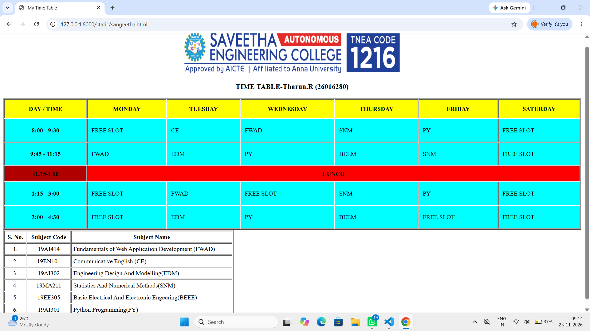

# Ex04 Time Table
## Date:18/11/2026

## AIM
To write a html webpage page to display your slot timetable.

## ALGORITHM
### STEP 1
Create a Django-admin Interface.

### STEP 2
Create an App inside the Django project.

### STEP 2
Create a static folder uder the created App and insert HTML code.

### STEP 3
Create a simple table using ```<table>``` tag in html with the relevant attributes.

### STEP 4
Add rows using ```<tr>``` tag.

### STEP 5
Add your course schedule using ```<td>``` tag.

### STEP 6
Execute the program using runserver command.

## PROGRAM

```<html>
<head>
<title>My Time Table</title>
</head>
<body>

<center>
    
    
</center>
<h3 align="center">TIME TABLE-Tharun.R (26016280)</h3>

<table border="2" width="100%" cellpadding="10" cellspacing="2">

<tr bgcolor="yellow" height="50">
<th>DAY / TIME</th>
<th>MONDAY</th>
<th>TUESDAY</th>
<th>WEDNESDAY</th>
<th>THURSDAY</th>
<th>FRIDAY</th>
<th>SATURDAY</th>
</tr>

<tr bgcolor="cyan" height="60">
<th>8:00 - 9:30</th>
<td>FREE SLOT</td>
<td>CE</td>
<td>FWAD</td>
<td>SNM</td>
<td>PY</td>
<td>FREE SLOT</td>
</tr>

<tr bgcolor="cyan" height="60">
<th>9:45 - 11:15</th>
<td>FWAD</td>
<td>EDM</td>
<td>PY</td>
<td>BEEM</td>
<td>SNM</td>
<td>FREE SLOT</td>
</tr>

<tr bgcolor="red" height="40">
<th bgcolor="blur">11.15-1.00</th>

<th colspan="7">LUNCH</th>
</tr>

<tr bgcolor="cyan" height="60">
<th>1:15 - 3:00</th>
<td>FREE SLOT</td>
<td>FWAD</td>
<td>FREE SLOT</td>
<td>SNM</td>
<td>PY</td>
<td>FREE SLOT</td>
</tr>

<tr bgcolor="cyan" height="60">
<th>3:00 - 4:30</th>
<td>FREE SLOT</td>
<td>EDM</td>
<td>PY</td>
<td>BEEM</td>
<td>FREE SLOT</td>
<td>FREE SLOT</td>
</tr>

</table>
<table border="2" width="600" cellpadding="5" cellspacing="2">

<tr>
<th>S. No.</th>
<th>Subject Code</th>
<th>Subject Name</th>
</tr>

<tr>
<td align="center">1.</td>
<td align="center">19AI414</td>
<td>Fundamentals of Web Application Development (FWAD)</td>
</tr>

<tr>
<td align="center">2.</td>
<td align="center">19EN101</td>
<td>Communicative English (CE)</td>
</tr>

<tr>
<td align="center">3.</td>
<td align="center">19AI302</td>
<td>Engineering Design And Modelling(EDM)</td>
</tr>

<tr>
<td align="center">4.</td>
<td align="center">19MA211</td>
<td>Statistics And Numerical Methods(SNM)</td>
</tr>

<tr>
<td align="center">5.</td>
<td align="center">19EE305</td>
<td>Basic Electrical And Electronic Engeering(BEEE)</td>
</tr>

<tr>
<td align="center">6.</td>
<td align="center">19AI301</td>
<td>Python Programming(PY)</td>
</tr>

</table>

</body>
</html>
```

## OUTPUT




## RESULT
The program for creating slot timetable using basic HTML tags is executed successfully.
