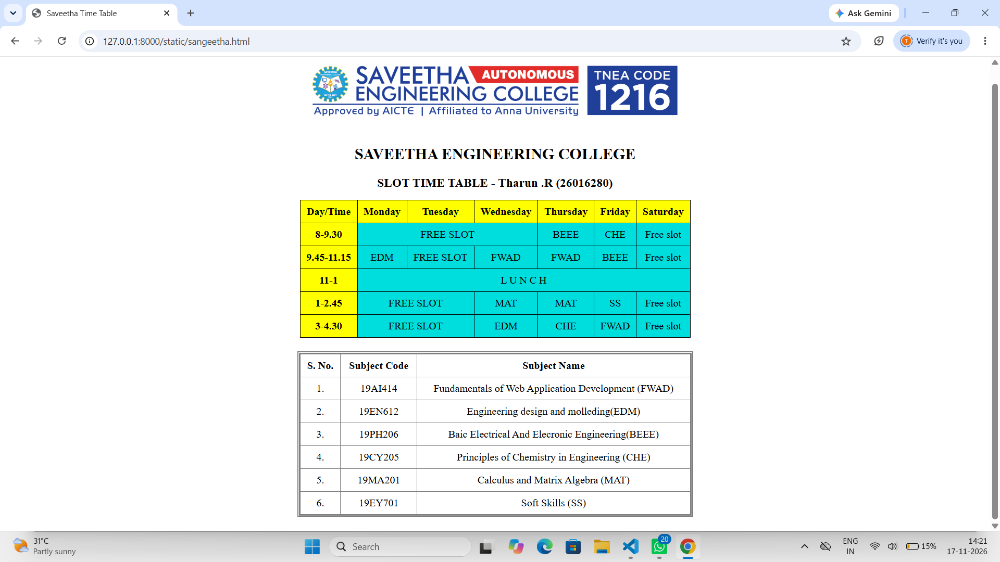

# Ex04 Time Table
## Date:17/11/2026

## AIM
To write a html webpage page to display your slot timetable.

## ALGORITHM
### STEP 1
Create a Django-admin Interface.

### STEP 2
Create an App inside the Django project.

### STEP 2
Create a static folder uder the created App and insert HTML code.

### STEP 3
Create a simple table using ```<table>``` tag in html with the relevant attributes.

### STEP 4
Add rows using ```<tr>``` tag.

### STEP 5
Add your course schedule using ```<td>``` tag.

### STEP 6
Execute the program using runserver command.

## PROGRAM
'''
<!DOCTYPE html>
<html>
<head>
<title>Saveetha Time Table</title>

<style>
body {
    text-align: center;
    font-family: "Times New Roman";
}

.logo {
    width: 580px;
    height: 120px;
    object-fit: contain;
    margin-top: 10px;
}

h3 {
    margin: 15px;
}

table {
    margin: 15px auto 25px;
    border-collapse: collapse;
    width: 600px;
}

th, td {
    border: 1px solid black;
    padding: 8px;
    text-align: center;
}

.timetable th {
    background-color: yellow;
}

.timetable td {
    background-color: #00dddd;
}

.subject {
    border-collapse: collapse;
    outline: 4px double gray;
}

.subject th,
.subject td {
    background-color: white;
    border: 1px solid gray;
}


</style>
</head>

<body>

<!-- COLLEGE LOGO -->


<h2>SAVEETHA ENGINEERING COLLEGE</h2>
<h3>SLOT TIME TABLE - Tharun .R (26016280)</h3>

<!-- TIME TABLE -->

<table class="timetable">

<tr>
<th>Day/Time</th>
<th>Monday</th>
<th>Tuesday</th>
<th>Wednesday</th>
<th>Thursday</th>
<th>Friday</th>
<th>Saturday</th>
</tr>

<tr>
<th>8-9.30</th>
<td colspan="3">FREE SLOT</td>
<td>BEEE</td>
<td>CHE</td>
<td>Free slot</td>
</tr>

<tr>
<th>9.45-11.15</th>
<td>EDM</td>
<td>FREE SLOT</td>
<td>FWAD</td>
<td>FWAD</td>
<td>BEEE</td>
<td>Free slot</td>
</tr>

<tr>
<th>11-1</th>
<td colspan="6">L U N C H</td>
</tr>

<tr>
<th>1-2.45</th>
<td colspan="2">FREE SLOT</td>
<td>MAT</td>
<td>MAT</td>
<td>SS</td>
<td>Free slot</td>
</tr>

<tr>
<th>3-4.30</th>
<td colspan="2">FREE SLOT</td>
<td>EDM</td>
<td>CHE</td>
<td>FWAD</td>
<td>Free slot</td>
</tr>

</table>

<!-- SUBJECT DETAILS -->

<table class="subject">

<tr>
<th>S. No.</th>
<th>Subject Code</th>
<th>Subject Name</th>
</tr>

<tr>
<td>1.</td>
<td>19AI414</td>
<td>Fundamentals of Web Application Development (FWAD)</td>
</tr>

<tr>
<td>2.</td>
<td>19EN612</td>
<td>Engineering design and molleding(EDM)</td>
</tr>

<tr>
<td>3.</td>
<td>19PH206</td>
<td>Baic Electrical And Elecronic Engineering(BEEE)</td>
</tr>

<tr>
<td>4.</td>
<td>19CY205</td>
<td>Principles of Chemistry in Engineering (CHE)</td>
</tr>

<tr>
<td>5.</td>
<td>19MA201</td>
<td>Calculus and Matrix Algebra (MAT)</td>
</tr>

<tr>
<td>6.</td>
<td>19EY701</td>
<td>Soft Skills (SS)</td>
</tr>

</table>

</body>
</html>
'''

## OUTPUT


## RESULT
The program for creating slot timetable using basic HTML tags is executed successfully.
